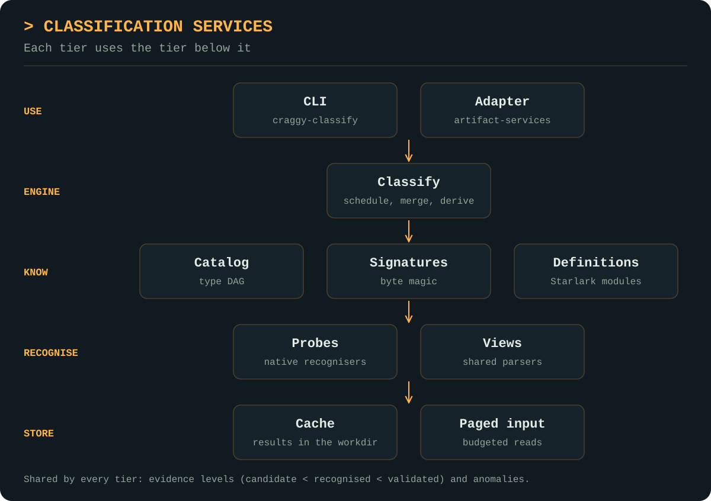

<picture>
  <source media="(prefers-color-scheme: dark)" srcset="docs/assets/craggy-wordmark-on-dark.svg">
  
</picture>

# Classification Services

A Go library and CLI that takes any input (a file, bytes or text) and
returns every type it can be shown to be, as a DAG: an APK is also a ZIP, and
a ZIP is also bytes. Content found inside the input (archive entries,
decompressed payloads, executable overlays, PEM blocks) is classified
recursively into a content DAG, and anomalies such as polyglots, path
traversal, extension mismatches and active PDF content are reported alongside
types. The core depends only on the standard library,
[Starlark](https://github.com/google/starlark-go) and
[foundation-kit](https://github.com/craggy-io/foundation-kit), whose `bundle`
package is the one path for loading definitions.

New formats are defined at runtime in Starlark: one module declares types,
signatures, classifiers and inline tests. A module can be checked, previewed
against the files the engine has already seen, and installed without
restarting. Results are cached in a caller-supplied working folder that
several processes can share.

## Features

- **Types as a DAG with evidence:** [catalogue](docs/catalog.md) of 187 types in 17 namespaces; every match is `candidate`, `recognised` or `validated`, and validators can [refute](docs/classify.md#merging-and-rejection) signature candidates.
- **Explainable results:** `Result.Explain(type)` returns the signature offsets, classifiers and inheritance path behind a type, plus any rejections.
- **Security-relevant anomalies:** [polyglots, ZIP slip, overlays, macros, PDF active content, unsigned or debuggable APKs](docs/recognisers.md#anomalies), and extension mismatches, graded `info`/`warning`/`critical`.
- **Recursive content DAG:** archive entries, compressed payloads, overlays and (at `Deep`) speculative decodings are classified in turn; identical content is one shared node, bounded by depth, node, size and expansion limits.
- **Runtime definitions with tests:** [Starlark modules](docs/definitions.md) with `test()` cases; `Check`, `Preview` and `Define` reject a module whose tests fail.
- **Definitions are bundles:** built-in, shipped and installed modules all load through foundation-kit's `bundle.Load`/`bundle.Live`. [Every definitions folder needs a `bundle.yaml`](docs/definitions.md#bundles) listing its modules; nothing is discovered from file names.
- **Shared, incremental cache:** [one entry per (content, classifier revision)](docs/cache.md), so installing a module reruns only its classifiers; explicit `Maintain` and cross-process `Refresh`.
- **Batch, CLI and observation:** `ClassifyMany`, `ClassifyDir`, the [`craggy-classify` CLI](docs/cli.md) with JSON lines, and observer events that the [artifact-services adapter](docs/artifact-services.md) maps onto its observability spans.

## Layer architecture

<p align="center">
  <a href="docs/assets/classification-services-architecture.svg">
    
  </a>
</p>

Dependencies run one way: `views` ← `probes` ← `classify`, and
`definitions` sees `views` but never `probes`. `evidence` is shared by all.

| Package | Responsibilities | Guide |
| --- | --- | --- |
| `classify` | Engine, sources, result DAG, explain, anomalies, definition lifecycle, batch | [Classify](docs/classify.md) |
| `definitions` | Starlark module loader, `ctx` API, inline tests | [Definitions](docs/definitions.md) |
| `catalog` | Type DAG, namespaces, ancestor sets, revisions | [Catalog](docs/catalog.md) |
| `signatures` | Compiled byte-signature matcher, CyberChef import | [Signatures](docs/signatures.md) |
| `probes`, `views` | Native recognisers and the shared parsers they use | [Recognisers](docs/recognisers.md) |
| `internal/cache`, `internal/paged` | Workdir layout, immutable entries, budgeted page cache | [Cache](docs/cache.md) |
| `cmd/craggy-classify` | Command-line interface | [CLI](docs/cli.md) |
| `adapters/artifactsvc` | Separate module: artifact-services integration | [Artifact Services](docs/artifact-services.md) |

## Usage

```go
e, err := classify.Open(ctx, workdir)
defer e.Close()

r, err := e.Classify(ctx, classify.File("app.apk"))
r.Primary                                   // "android.apk"
r.Is("archive.zip")                         // true: inherited
r.IsAtLeast("android.apk", classify.Validated)
ex, _ := r.Explain("android.apk")           // evidence chain
for _, a := range r.Anomalies { ... }       // e.g. android.debuggable
for _, c := range r.Children { ... }        // classes.dex -> android.dex
```

```sh
craggy-classify --tree --fail-on critical samples
craggy-classify check samples/widgets && craggy-classify define samples/widgets   # a bundle: samples/widgets/bundle.yaml
```

Start with the [documentation index](docs/README.md), the
[walkthrough](docs/walkthrough.md), or the example files in
[samples](samples/README.md). Coming from cclab-classify? See
[migration](docs/migration.md).

For coding-agent integration and repository development guidance, see [AGENTS.md](AGENTS.md).

## Development

Requires Go 1.27 or newer. The adapter is a separate module joined by `go.work`.

```sh
go build ./... && go vet ./... && go test ./...
go test -race ./...
go test ./integration -update        # after an intended change to results
(cd adapters/artifactsvc && go test ./...)
```

See [verification](docs/verification.md) for fuzz targets, benchmarks and what has been run.
