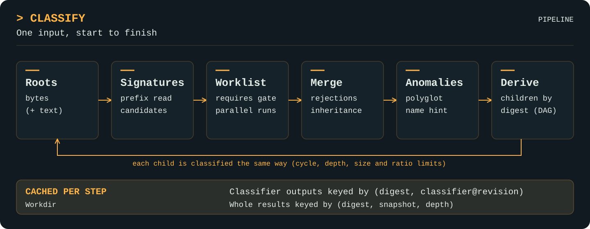

# Classify

[Project](../README.md) · [Documentation index](README.md) · [Walkthrough](walkthrough.md)

Package `classify` is the engine and the public API.

## Purpose

Return every type content can be shown to be, with the evidence for each,
the anomalies noticed along the way, and the same answer for everything
derived from it.

## Mental model

There are two graphs. The **type DAG** ([catalog](catalog.md)) answers "what
is this content?": an APK is a ZIP is bytes. The **content DAG** answers
"what content is inside or encoded in this content?": an APK contains
`classes.dex`. Each node of the content DAG is a `*Result` and is classified
the same way.

<p align="center">
  <a href="assets/classify-pipeline.svg">
    
  </a>
</p>

## Opening an engine

```go
e, err := classify.Open(ctx, workdir,
    classify.WithLimits(classify.Limits{Timeout: 30 * time.Second}),
    classify.WithAutoRefresh(5*time.Second),
)
defer e.Close()
```

`workdir` is required and is created if missing ([cache](cache.md)). Options:

| Option | Effect |
| --- | --- |
| `WithoutBuiltins()` | Omit the built-in catalogue, signatures and classifiers (the roots `bytes` and `text` remain). |
| `WithDefinitions(fs.FS)` | Load extra `*.star` modules shipped by an importer. |
| `WithClassifier(Classifier)` | Register a native Go classifier. |
| `WithLimits(Limits)` | Work limits (below). |
| `WithObserver(Observer)` | Receive events for every operation. |
| `WithAutoRefresh(interval)` | Pick up definitions other processes installed, checking at most once per interval. |

`Close` is idempotent; afterwards operations return `ErrClosed`. The workdir
is kept.

## Sources

`File(path)`, `Bytes(b)`, `Text(s)` (also asserts `text`) and
`ReaderAt(r, size)`. `src.Named("invoice.pdf")` attaches a name hint: names
never change which types hold, but they enable the `extension-mismatch`
anomaly and are visible to classifiers as `ctx.name` / `Input.Name()`. `File`
uses the base name automatically. Invalid sources return `ErrInvalidSource`.

## Results

```go
type Result struct {
    Digest, Name, Primary string
    Size        int64
    Matches     []Match      // every type that holds, most specific first
    Rejected    []Rejection  // refutations
    Anomalies   []Anomaly    // most severe first
    Children    []Child      // derived content
    Complete    bool         // this node only
    Limitations []string     // this node only
}
```

- `Is(t)`, `IsAtLeast(t, level)` and `Get(t)` are DAG-aware: inherited types appear in `Matches` with `Direct == false` and `Via` naming the direct matches that imply them.
- `Primary` is chosen among the most specific matches (no matched descendant): concrete before abstract, then higher evidence, then a signature at offset 0 (an ELF with a ZIP appended is primarily an ELF), then declared priority, depth and name.
- `Explain(t)` returns an `Explanation`: whether `t` holds, at what level, directly or via what, the `Evidence` behind it (signature rule and offset, or classifier ID), and any `Rejections`. `String()` renders it.
- `Walk(fn)` visits each node once with its derivation path. `AllLimitations()` lists every node's limitations prefixed with its path; check it rather than the root's `Complete` when truncation anywhere matters. `HasAnomaly(code)` checks one node; `MaxSeverity()` checks the whole DAG.

Results marshal to JSON (levels and severities as names). Shared child nodes
are written once per occurrence.

## Classification algorithm

1. **Roots.** Assert `bytes` (validated); for `Text` sources also `text`.
2. **Signatures.** Read the longest prefix any rule needs, once, and add `candidate` matches with their rule and offset ([signatures](signatures.md)). `WithDepth(Quick)` stops here.
3. **Worklist.** Run every classifier whose `Requires` all hold (including by inheritance). Classifiers ready together run in parallel, bounded by `Limits.Parallel`; one that requires a type another ready classifier produces waits a round, so it sees the validated facet rather than a signature candidate. Each classifier runs at most once per node, and may only assert types it declares in `Produces`.
4. **Merge.** Assertions of a type merge to the highest level, whose metadata wins; `By` lists every asserting classifier.
5. **Anomalies.** Classifier anomalies are collected, the engine adds `polyglot`, and at the root a name hint may add `extension-mismatch`.
6. **Derive.** Children are classified breadth-first on the same worker pool.

### Merging and rejection

A classifier can refute a type (`Refute`, `ctx.reject`). A rejection at level
L removes every assertion of that type below L, which is how a structural
validator removes a false-positive signature candidate. Rejections are kept
in `Result.Rejected`, with `Removed` set when they removed something.

## Derived content

Derivers are classifiers with `Spec.Derives` (Go) or `derives = True`
(Starlark). A derived child is either bytes, a byte range of its parent (no
copy: ZIP stored entries, tar members, executable overlays) or a reader.
Children are keyed by digest, so identical content is one shared `*Result`;
a child equal to one of its ancestors is reported as a cycle.

Speculative children (base64 or hex decodings of text) are only produced at
`WithDepth(Deep)` and are kept only if they classify as something more than
`bytes`/`text` at `recognised` or better, or have kept children of their own.

`Recurse(fn)` prunes children by path or by `Child` (whose `Result` carries
only `Digest` and `Size` at that point). Calls with a filter bypass the
whole-result cache.

## Limits

All limits record limitations rather than failing.

| Field | Default | Bounds |
| --- | --- | --- |
| `MaxBytes` | 64 MiB | Bytes read from one node's content (shared by its classifiers). |
| `Timeout` | none | One `Classify` call. |
| `Parallel` | min(4, CPUs) | Concurrent classifiers; workers in batch calls. |
| `ScriptSteps` | 4,000,000 | Starlark steps per classifier run. |
| `MaxDepth` | 8 | Derivation depth. |
| `MaxChildren` | 10,000 | Children per node. |
| `MaxNodes` | 100,000 | Derived nodes per call. |
| `MaxDerivedBytes` | 512 MiB | Derived bytes per call, and per child. |
| `MaxExpansion` | 1000 | Ratio of derived to parent bytes (ZIP and gzip bomb guard). |
| `InlineChild` | 4 MiB | Children above this are spooled to `workdir/spool`. |

Failed, cancelled or step-limited classifier runs are reported as
limitations and are never cached.

## Native classifiers

```go
classify.WithClassifier(classify.ClassifierFunc{
    S: classify.Spec{ID: "acme-widget", Produces: []string{"acme.widget"},
        Types: []classify.TypeInfo{{Name: "acme.widget", Parents: []string{"bytes"}}}, Revision: "2"},
    Run: func(ctx context.Context, in *classify.Input) (classify.Output, error) {
        z, err := classify.View[*views.Zip](in, "zip")
        ...
        return classify.Output{Assertions: []classify.Assertion{classify.Assert("acme.widget", classify.Validated, nil)}}, nil
    },
})
```

`Input` offers budgeted `Read`/`Prefix`/`ReadAt`, `Text`, `JSON`, memoised
`View(name)` (and the generic `View[T]`), `Facet(t)` for matches established
when the classifier was scheduled, and `Name()`. Change `Spec.Revision` when
behaviour changes so cached outputs are recomputed.

## Batch work

- `ClassifyMany(ctx, sources, fn)` uses `Limits.Parallel` workers and one definitions snapshot; `fn(i, result, err)` is called once per source.
- `ClassifyDir(ctx, root, fn)` walks regular files (links and special files are skipped, as is the workdir itself). Returning an error from `fn` stops the walk, and `ClassifyDir` returns it.

## Observation

An `Observer` receives an `Event` when each operation starts and once when it
ends (`Final`). `ParentID` nests `classifier` runs inside `node`s inside a
`classify` call. Final events carry the operation's own counters:
`bytes_read`, `signature_hits`, `classifiers_run`, `classifiers_cached`,
`children`, `anomalies`, `cache_hit`, `nodes`. Definition operations (`define`,
`remove`, `check`, `preview`, `refresh`, `maintain`, `open`) are reported too.
Pass one per call with `Observe(o)`.

## Concurrency

An `Engine` is safe for concurrent use. Every call captures the current
definitions snapshot when it starts; `Define`, `Remove` and `Refresh` swap the
snapshot atomically and never affect calls in flight. Concurrent calls on the
same content share one run of each classifier.
